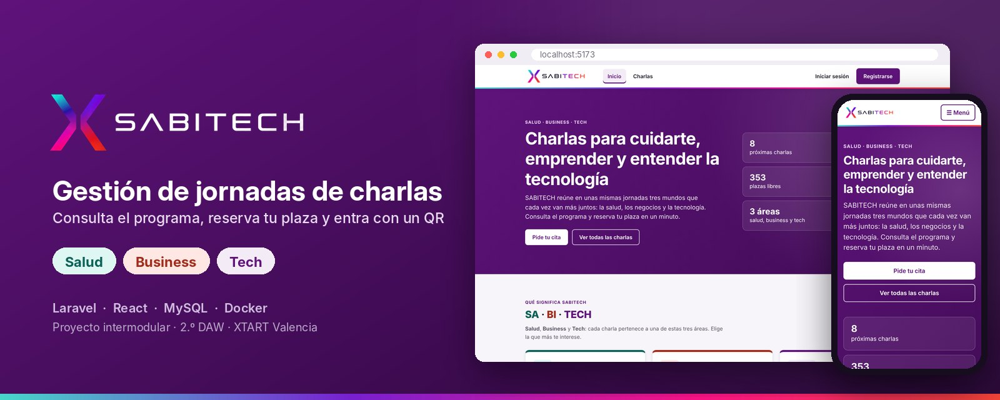
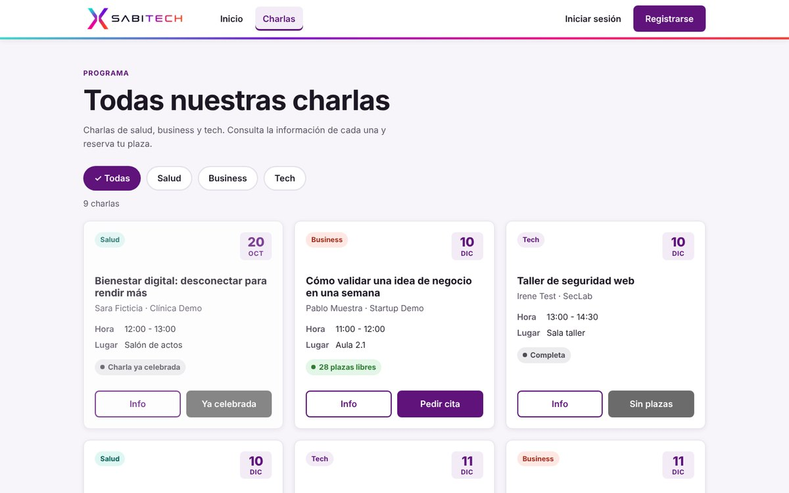
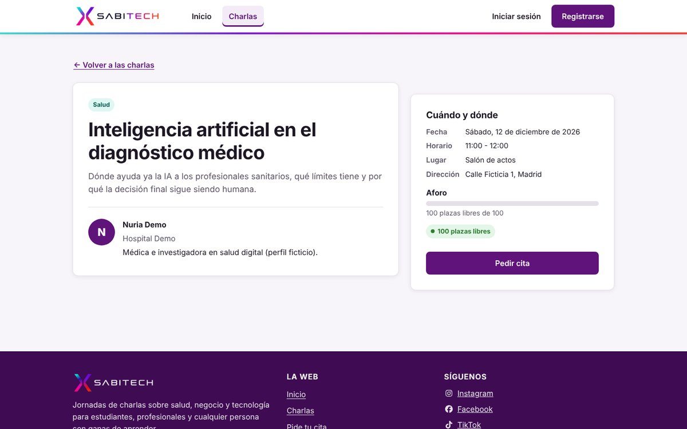
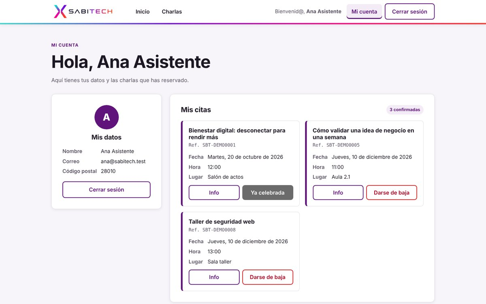
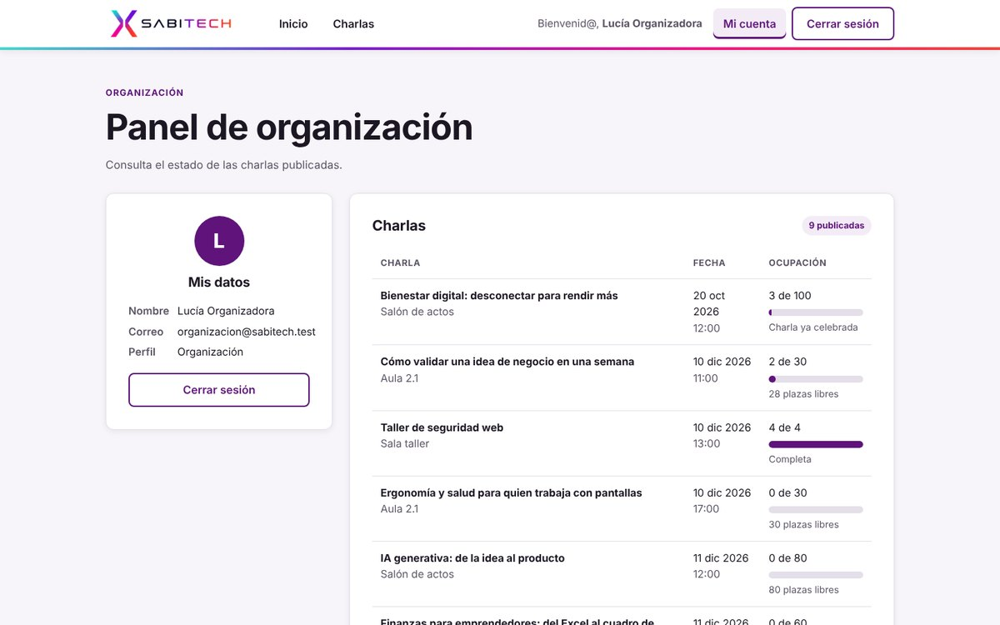
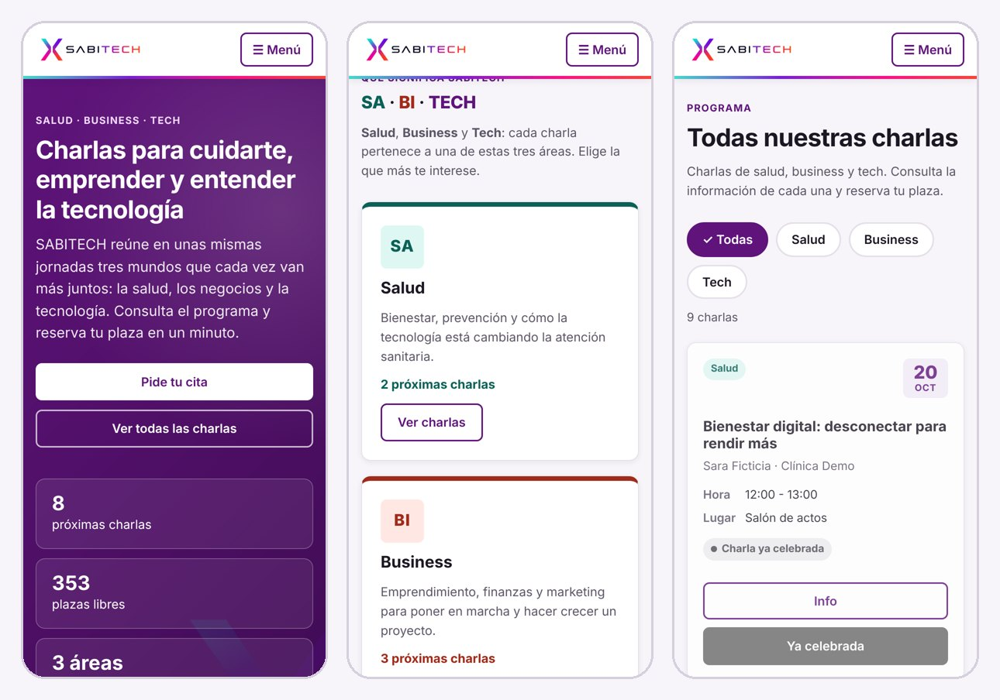
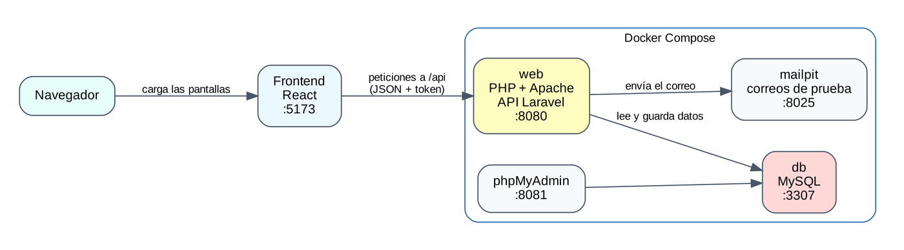

<p align="center">
  
</p>

<p align="center">
  
  
  
  
  
  
</p>

# SABITECH WEB

**SABITECH** son unas jornadas de charlas sobre tres áreas que forman su nombre: **SA**lud, **BI** (Business) y **TECH**. **SABITECH WEB** es la aplicación web para organizarlas: el público consulta el programa y reserva su plaza, recibe la confirmación por correo y entra a la charla con un **código QR que cambia cada 30 segundos**. La organización ve quién se ha inscrito y quién ha asistido.

Es el proyecto intermodular de 2.º de Desarrollo de Aplicaciones Web (XTART Valencia, curso 2026-2027). Lo desarrolla **PGD Technologies S.L.**, la empresa ficticia que hemos creado para el encargo.

## Índice

- [Qué hace](#qué-hace)
- [Capturas](#capturas)
- [Arquitectura y tecnologías](#arquitectura-y-tecnologías)
- [Cómo arrancar el proyecto](#-cómo-arrancar-el-proyecto)
- [API](#api)
- [Documentación por módulo](#documentación-por-módulo)
- [Equipo y empresa](#equipo-y-empresa)
- [Flujo de trabajo con Git](#flujo-de-trabajo-con-git)

---

## Qué hace

| Funcionalidad | Perfil | Estado |
|---|---|---|
| Consultar el programa, filtrar por área (Salud, Business, Tech) y ver el detalle de cada charla | Visitante | ✅ Hecho |
| Registrarse, iniciar y cerrar sesión | Todos | ✅ Hecho |
| Reservar plaza sin superar el aforo, aunque dos personas pidan la última a la vez | Asistente | ✅ Hecho |
| Ver mis reservas y cancelarlas (libera la plaza) | Asistente | ✅ Hecho |
| Correo de confirmación con la referencia de la reserva | Asistente | 🧪 Prototipo en el backend |
| QR que cambia cada 30 s, validado por el servidor | Asistente / personal de acceso | 🧪 Prototipo en el backend |
| Ver las inscripciones y asistencias de una charla | Organización | 🧪 Prototipo en el backend |
| Validación manual de la asistencia y gestión de charlas | Personal de acceso / organización | ⏳ Pendiente |

🧪 **Prototipo en el backend:** la API ya lo hace y tiene tests, pero falta la pantalla. Los requisitos completos están en [`documents/Proyecto_Intermodular`](documents/Proyecto_Intermodular).

**Reglas que comprueba siempre el servidor:**
- Una sola reserva por persona y charla.
- No se reserva una charla llena ni una que ya ha empezado.
- Solo puedes cancelar tus propias reservas.
- Un QR caducado o manipulado se rechaza.
- La asistencia no se registra dos veces.
- Cada perfil solo accede a lo suyo.

---

## Capturas

| Programa con filtro por área | Detalle de una charla |
|---|---|
|  |  |
| **Mi cuenta: mis citas** | **Panel de organización** |
|  |  |

**En el móvil:** el menú se pliega, las tarjetas pasan a una columna y el carrusel se desliza con el dedo.



---

## Arquitectura y tecnologías



| Parte | Tecnología | Para qué |
|---|---|---|
| Frontend | React 19 + Vite | Las pantallas. Llama a la API con `fetch` y guarda el token de sesión |
| Backend | PHP 8.4, Laravel 13, Sanctum | API REST con las reglas de negocio: aforo, permisos, correo y QR |
| Base de datos | MySQL 8.4 | 11 tablas, creadas con migraciones y cargadas con datos ficticios |
| Correo de pruebas | Mailpit | Recibe los correos de confirmación sin enviarlos a nadie real |
| Entorno | Docker Compose | Levanta web, base de datos, phpMyAdmin y Mailpit con un solo comando |
| Pruebas | PHPUnit (24 tests) y Postman | Reglas de reserva, permisos, correo y QR |

Más detalle en el [diagrama de arquitectura](documents/Despliegue) y el [plan de publicación](documents/Despliegue).

---

## 🚀 Cómo arrancar el proyecto

Guía pensada para levantar todo desde cero en Windows (PowerShell). En Linux o macOS los comandos son los mismos; solo cambia `Copy-Item` por `cp`.

### 0. Qué necesitas antes de empezar
- **Git** y **Docker Desktop** (abierto y en marcha antes de ejecutar nada).
- **Node.js** (solo para el frontend React).
- Estos puertos de tu ordenador libres: `8080`, `8081`, `8025`, `1025` y `3307`.

Servicios de Docker (`compose.yaml`):

| Servicio | Qué es | Dirección |
|---|---|---|
| `web` | Laravel sobre PHP 8.4 + Apache | http://localhost:8080 |
| `db` | MySQL 8.4 | solo por dentro de Docker (y `127.0.0.1:3307` para Workbench) |
| `phpmyadmin` | Ver la base de datos en el navegador | http://localhost:8081 |
| `mailpit` | Buzón de laboratorio: aquí llegan los correos de prueba | http://localhost:8025 |

### 1. Primera vez: preparar el proyecto
Solo hay que hacerlo **una vez en cada ordenador**. Hay ficheros que no se suben a Git (`.env`, `app/.env`, `app/vendor/`, permisos de `storage`) y cada uno debe crearlos en su máquina.

**1.1. Clonar y cambiar de rama**
```
git clone https://github.com/pablopedron/SABITECH.git
cd SABITECH
git checkout MainPruebasV3
```

**1.2. Variables de Docker.** Copia la plantilla y cambia las contraseñas:
```
Copy-Item .env.example .env
```
El `.env` de la raíz debe quedar así (con tus contraseñas):
```
MYSQL_DATABASE=sabitech_web
MYSQL_USER=sabitechUser
MYSQL_PASSWORD=tu_password
MYSQL_ROOT_PASSWORD=tu_password_root
MYSQL_HOST_PORT=3307
```

**1.3. Variables de Laravel.** Los datos de conexión a la base de datos los pasa Docker desde el `.env` de la raíz, así que aquí solo hay que copiar la plantilla:
```
Copy-Item app/.env.example app/.env
```

**1.4. Instalar Laravel, generar la clave y dar permisos.** Puede tardar varios minutos:
```
docker compose run --rm --no-deps -e COMPOSER_PROCESS_TIMEOUT=0 web composer install --no-scripts
docker compose run --rm --no-deps web php artisan key:generate
docker compose run --rm --no-deps web php artisan package:discover
docker compose run --rm --no-deps -u root web mkdir -p storage/framework/cache storage/framework/sessions storage/framework/views storage/logs bootstrap/cache
docker compose run --rm --no-deps -u root web touch storage/logs/laravel.log
docker compose run --rm --no-deps -u root web chown -R www-data:www-data storage bootstrap/cache
docker compose run --rm --no-deps -u root web chmod -R ug+rwX storage bootstrap/cache
```

**1.5. Levantar los contenedores**
```
docker compose up -d
docker compose ps
```
Deben aparecer `web`, `db` (con `healthy`), `phpmyadmin` y `mailpit` en `running`. Si `db` aún no está `healthy`, espera medio minuto y repite `docker compose ps`.

**1.6. Crear las tablas y cargar los datos de prueba**
```
docker compose exec web php artisan migrate:fresh --seed
```
Deben salir 10 migraciones con `DONE` y al final `Seeding database`.

**1.7. Comprobar que todo funciona**
- http://localhost:8080/api/health debe mostrar `{"estado":"ok","base_de_datos":"sabitech_web"}`.
- `docker compose exec web php artisan db:show --counts` lista las tablas con sus filas (por ejemplo `users` 8, `talks` 10, `talk_user` 11).
- En phpMyAdmin (http://localhost:8081, usuario y contraseña de tu `.env`) aparece la base `sabitech_web` con 11 tablas.

### 2. Datos de prueba
Todos los datos son ficticios. **Contraseña de todos los usuarios: `Sabitech2026!`**

| Usuario | Email | Rol |
|---|---|---|
| Lucía Organizadora | `organizacion@sabitech.test` | organizacion |
| Mario Acceso | `acceso@sabitech.test` | personal_acceso |
| Ana, Bruno, Carla, Diego, Elena | `ana@`, `bruno@`, `carla@`, `diego@`, `elena@` + `sabitech.test` | asistente |
| Fabio Inactivo | `fabio@sabitech.test` | asistente (cuenta desactivada) |

Hay **10 charlas** repartidas en las tres áreas (**Salud**, **Business** y **Tech**; 9 publicadas). Algunas están pensadas para probar casos concretos:

| Charla | Caso |
|---|---|
| 1 · Bienestar digital (Salud) | Ya celebrada, con reservas y asistencias |
| 2 · Cómo validar una idea de negocio (Business) | Con plazas y reservas de Ana y Bruno |
| 3 · Taller de seguridad web (Tech) | **Completa** (4 de 4), para probar «reserva sin plazas» |
| 4 · Telemedicina (Salud) | Borrador: no aparece en la web |
| 5 · IA generativa (Tech) | Con plazas libres y sin reservas |

También hay correos de prueba en estado enviado, fallido y pendiente.

### 3. Día a día

| Qué quiero hacer | Comando |
|---|---|
| Encender el proyecto | `docker compose up -d` |
| Apagarlo (conserva la base de datos) | `docker compose down` |
| Ver si todo está en marcha | `docker compose ps` |
| Ver los mensajes de un servicio | `docker compose logs web --tail 40` |
| Borrar la base y cargarla de nuevo con datos | `docker compose exec web php artisan migrate:fresh --seed` |
| Ver qué migraciones están aplicadas | `docker compose exec web php artisan migrate:status` |
| Ver todas las rutas de la API | `docker compose exec web php artisan route:list` |
| Ejecutar cualquier comando de Laravel | `docker compose exec web php artisan ...` |
| Instalar una librería PHP nueva | `docker compose exec web composer require nombre/paquete` |
| Borrar TODO (contenedores y base de datos) | `docker compose down -v` |

Notas importantes:
- `migrate:fresh` **borra todas las tablas** y las vuelve a crear. Úsalo solo en desarrollo.
- Después de cambiar el `.env` de la raíz, ejecuta `docker compose up -d` para que los contenedores lo lean.
- Cuando alguien cambie una migración, hay que ejecutar `migrate:fresh --seed` para ver el cambio.

### 4. Base de datos
La base de datos se crea **solo con Laravel**: las tablas con las migraciones (`app/database/migrations`) y los datos ficticios con el seeder (`app/database/seeders/DatabaseSeeder.php`). `documents/Desarrollo_Servidor/sabitechDDBB.sql` es solo la **constancia del modelo en SQL puro** para la memoria; ni Docker ni Laravel lo ejecutan. Si cambia una migración, hay que actualizar también ese fichero.

### 5. Pruebas automáticas del backend
Los tests están en `app/tests/Feature` y usan **MySQL**, en una base de datos propia (`sabitech_test`), **nunca la de desarrollo**. Si la configuración apuntara a otra base de datos, los tests se paran antes de tocar nada.

Hay **24 tests** en cuatro ficheros:

| Fichero | Qué comprueba |
|---|---|
| `ReservasTest.php` (7) | Reserva válida, repetida (409), sin plazas (409), que sigue guardada al volver a consultar, que sin sesión no se puede reservar (401), que cancelar libera la plaza y que nadie cancela una reserva ajena (404) |
| `CorreoTest.php` (3) | Se envía el correo al reservar, lleva los datos de la reserva y, si el correo falla, la reserva se guarda igual |
| `QrTest.php` (10) | Código vigente, que cambia cada 30 s, caducado, manipulado, margen de 5 s, repetición sin duplicar, QR ajeno, reserva cancelada y que un asistente no puede escanear |
| `PermisosTest.php` (4) | Solo la organización ve las inscripciones (asistente 403, personal de acceso 403, sin sesión 401) |

**Primera vez** (la base de datos `sabitech_test` hay que crearla una vez; si acabas de crear el volumen con `docker compose down -v`, ya la crea Docker solo):
```
docker compose up -d
docker compose exec db sh /docker-entrypoint-initdb.d/01-crear-bd-test.sh
```

**Ejecutar los tests:**
```
docker compose exec web php artisan test
```
Cada prueba se ejecuta dentro de una transacción que se deshace al terminar, así que no se mezclan datos. Para ejecutar solo un fichero: `docker compose exec web php artisan test --filter=ReservasTest`.

### 6. Frontend React (en tu ordenador, necesita Node.js)
```
cd frontend
npm install
npm run dev
```
Abre http://localhost:5173

El frontend habla con la API del backend, así que **Docker debe estar levantado** (`docker compose up -d`) y la base de datos cargada (paso 1.7). Por defecto usa `http://localhost:8080/api`. Si tu API está en otra dirección, copia `frontend/.env.example` como `frontend/.env`, cambia `VITE_API_URL` y reinicia `npm run dev`.

Cuentas para probar (contraseña `Sabitech2026!`): `ana@sabitech.test` (asistente) y `organizacion@sabitech.test` (panel de organización). Más detalles del frontend en [`frontend/README.md`](frontend/README.md).

### 7. Problemas frecuentes

**`ports are not available ... 3307` al hacer `docker compose up -d`**
Windows tiene ese puerto reservado. Añade `MYSQL_HOST_PORT=3310` a tu `.env` y vuelve a ejecutar `docker compose up -d`. Ese puerto solo se usa para MySQL Workbench; Laravel no lo necesita.

**`Fatal error: Uncaught ReflectionException: Class "view" does not exist` en http://localhost:8080**
Es el síntoma de que Laravel no ha podido arrancar y el error real queda escondido. Sigue este orden:
1. Mira si `web` está en marcha: `docker compose ps -a`. Si `web` no está `running`, lo que ves en el puerto 8080 **no es SABITECH**, sino otro programa (por ejemplo un contenedor de otro proyecto). Lista los contenedores con `docker ps`, para el que use el `8080` con `docker stop NOMBRE` y ejecuta `docker compose up -d`.
2. Comprueba que existen `app/.env` y `app/vendor/autoload.php` (`Test-Path app/.env`, `Test-Path app/vendor/autoload.php`). Si alguno da `False`, repite el paso **1.3** y el **1.4**.
3. Mira el error real: `docker compose exec web tail -n 30 storage/logs/laravel.log` y `docker compose logs web --tail 40`.
4. Limpia las cachés viejas y reinstala si hace falta:
```
Remove-Item -Recurse -Force app/vendor
Remove-Item -Force app/bootstrap/cache/*.php -ErrorAction SilentlyContinue
Remove-Item -Force app/storage/framework/views/*.php -ErrorAction SilentlyContinue
docker compose build web
```
y repite el paso **1.4** y `docker compose up -d`.

Reiniciar Docker o hacer `docker compose down -v` **no arregla** este error: lo que falla vive en la carpeta `app/`, que Docker no toca.

**Error 1419 (`You do not have the SUPER privilege...`) al hacer `migrate:fresh`**
MySQL se creó sin la opción que permite crear triggers. Ejecuta `docker compose down -v` y `docker compose up -d`, y repite el paso **1.6**.

**Antes usaba la base `sabitechDB`**
Cambia `MYSQL_DATABASE` a `sabitech_web` en tu `.env` y ejecuta `docker compose down -v` y `docker compose up -d` (borra el volumen de MySQL), y repite el paso **1.6**.

**`composer install` da error de timeout**
`COMPOSER_PROCESS_TIMEOUT=0` (ya incluido en el comando) lo evita; puede tardar varios minutos. Si el proyecto está en una carpeta sincronizada con OneDrive (por ejemplo `Desktop`), muévelo a algo como `C:\dev\SABITECH`: OneDrive bloquea ficheros mientras los sincroniza.

**`ERROR: service "web" is not running` al ejecutar `docker compose exec web ...`**
Los contenedores no están arrancados. Ejecuta `docker compose up -d` y mira `docker compose ps`.

### 8. Organización del repositorio
```
SABITECH/
├── app/            Backend Laravel (API, migraciones, seeders)
├── frontend/       Frontend React + Vite
├── documents/      Documentación, una carpeta por módulo:
│   ├── Desarrollo_Cliente/      Frontend
│   ├── Desarrollo_Servidor/     Diccionario de datos, modelo en SQL y colección de Postman
│   ├── Despliegue/              Diagrama de arquitectura y plan de publicación
│   ├── Diseno_Interfaces/       Prototipos, guía de estilos, logos y responsive
│   ├── IPE/                     Empresa PGD
│   ├── Digitalizacion/
│   ├── Ingles/                  Informe de vídeos sobre IA
│   ├── Proyecto_Intermodular/   Memoria, Gantt e informe de IA
│   └── rubricas_requerimientos/ Enunciado y rúbricas
├── docker/         Configuración de Apache (web) y script que crea la BD de pruebas (MySQL)
├── .github/readme/ Imágenes de este README
├── compose.yaml    Servicios de Docker
├── dockerfile      Imagen del contenedor web (PHP 8.4 + Apache)
├── openapi.json    Contrato de la API
└── .env.example    Plantilla de variables de Docker
```


Los ficheros `.env`, `app/.env` y `app/vendor/` no se suben a GitHub (están en `.gitignore`). El flujo de ramas está en [Flujo de trabajo con Git](#flujo-de-trabajo-con-git).

---

## API

Todas las rutas empiezan por `http://localhost:8080/api`. Las privadas necesitan la cabecera `Authorization: Bearer <token>`, con el token que devuelven `/login` o `/register`.

| Método | Ruta | Quién | Para qué |
|---|---|---|---|
| GET | `/talks` (`?category_id=`) | Cualquiera | Charlas publicadas, con filtro por área (1 Salud, 2 Business, 3 Tech) |
| GET | `/talks/{id}` | Cualquiera | Detalle de una charla |
| POST | `/register` · `/login` | Cualquiera | Crear cuenta o iniciar sesión (devuelven el token) |
| GET · POST | `/me` · `/logout` | Con sesión | Mis datos · cerrar sesión |
| POST | `/talks/{id}/inscribe` | Con sesión | Reservar plaza (envía el correo) |
| GET | `/me/reservations` | Con sesión | Mis reservas |
| POST | `/reservations/{id}/cancel` | Dueño de la reserva | Cancelar y liberar la plaza |
| GET | `/reservations/{id}/qr` | Dueño de la reserva | Código QR actual |
| POST | `/attendances/scan` | Personal de acceso | Escanear el QR y registrar la asistencia |
| GET | `/talks/{id}/reservations` | Organización | Inscripciones de una charla y quién ha asistido |

- **Contrato completo:** [`openapi.json`](openapi.json), con las entradas, las respuestas y los errores.
- **Colección de Postman:** [`documents/Desarrollo_Servidor/SABITECH_API.postman_collection.json`](documents/Desarrollo_Servidor). Tiene 32 peticiones ordenadas que recorren todo el flujo (registro → reserva → QR → organización → cancelación) y comprueban solas el resultado. Impórtala en Postman y ejecútala con *Run collection*.

---

## Documentación por módulo

| Módulo | Carpeta | Qué hay |
|---|---|---|
| Desarrollo web en entorno cliente | [`Desarrollo_Cliente`](documents/Desarrollo_Cliente) | Eventos, estados y errores del frontend (en preparación) |
| Desarrollo web en entorno servidor | [`Desarrollo_Servidor`](documents/Desarrollo_Servidor) | Diccionario de datos, modelo en SQL y colección de Postman |
| Despliegue de aplicaciones web | [`Despliegue`](documents/Despliegue) | Diagrama de arquitectura y plan de publicación |
| Diseño de interfaces web | [`Diseno_Interfaces`](documents/Diseno_Interfaces) | Prototipo, [guía de estilos](documents/Diseno_Interfaces/guia-estilos.md), logos y revisión de responsive y accesibilidad |
| Itinerario personal para la empleabilidad II | [`IPE`](documents/IPE) | Plan de empresa de PGD Technologies |
| Digitalización | [`Digitalizacion`](documents/Digitalizacion) | Gestión manual frente a digital |
| Inglés Oral | [`Ingles`](documents/Ingles) | Informe de vídeos sobre IA en programación |
| Proyecto intermodular | [`Proyecto_Intermodular`](documents/Proyecto_Intermodular) | Requisitos, Gantt, reparto, memoria e informe de uso de IA |

El enunciado y las rúbricas están en [`documents/rubricas_requerimientos`](documents/rubricas_requerimientos).

---

## Equipo y empresa

| Integrante | GitHub | Responsabilidad principal |
|---|---|---|
| **Pablo Pedrón** | [@pablopedron](https://github.com/pablopedron) | Backend (Laravel), base de datos, Docker y despliegue |
| **Alejandro Gutierrez** | [@AlejandroGutierrezDEV](https://github.com/AlejandroGutierrezDEV) | Backend (Laravel) y empresa PGD |
| **David Clemente** | [@Daclus](https://github.com/Daclus) | Frontend (React), interfaces, Digitalización e Inglés |

**PGD Technologies S.L.** es la empresa **ficticia** que recibe el encargo de SABITECH: una microempresa de desarrollo web con sede en Paterna (Valencia), organizada como sociedad limitada y con tres socios al 33,3 %. Su plan de empresa (forma jurídica, organigrama, costes y tarifas) está en [`documents/IPE`](documents/IPE).

---

## Flujo de trabajo con Git

- **`MainPruebasV3`:** versión de trabajo del equipo. Pasará a ser `main`.
- **`develop/backendV3` y `develop/frontendV4`:** ramas de integración del backend y del frontend.
- **Ramas de tarea:** cada tarea se hace en una rama `feature/...` (o `fix/...`, `docs/...`) creada desde la `develop` correspondiente. Se integra con un **Pull Request** que revisa otra persona del equipo.
- **Ficheros que no se suben:** `.env`, `app/.env` y `app/vendor/` (están en `.gitignore`). Nunca se suben contraseñas: se usan las plantillas `.env.example`.

---

<p align="center">
  Proyecto intermodular · 2.º DAW · XTART Valencia · 2026-2027<br>
  Desarrollado por PGD Technologies S.L. (empresa ficticia del proyecto)
</p>
